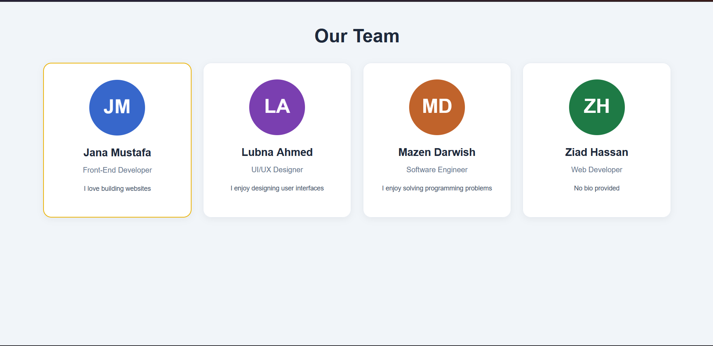

# Mini Profile Card

A simple React application that displays profile cards using
components, JSX, props, and map().

## How to Run

npm install
npm run dev

## Predictions

### 1. Missing Key
Prediction: The cards will appear, but React will show a warning.

Actual: The cards still appeared normally, but React showed
"Each child in a list should have a unique 'key' prop."
in the browser console.

### 2. Lowercase Component
Prediction: React will treat profileCard as an HTML element.

Actual: The profile cards disappeared, and React showed
warnings about incorrect casing and an unrecognized tag.
React components must start with a capital letter.

### 3. Default Bio with Null
Prediction: The default value will not appear because null is not undefined.

Actual: Ziad's biography was empty. The default value
"No bio provided" did not appear because destructuring
defaults only work with undefined or missing properties,
not null.

## Screenshot

